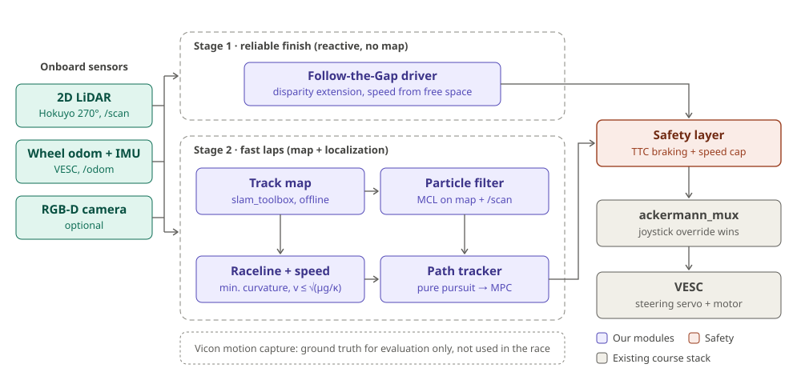

::: {.hero-section}

# NoCrash: Fast, Crash-Free F1TENTH Time Trials {.title}

::: {.subtitle}
A LiDAR-only autonomy stack: reactive driving for a guaranteed finish, a map-based raceline for speed, and a safety layer that keeps the car off the walls.
:::

<!-- TODO: replace "Teammate 3" with the third member's name before 10/19 11:59 PM -->
::: {.author-list}

**Zhen Wu**,
**Ted Goh**,
**Teammate 3**

:::

::: {.affiliation-list}

Team NoCrash · ECE 484 Principles of Safe Autonomy, Fall 2026 · University of Illinois Urbana-Champaign

:::

::: {.button-row}

[[ Approach]{.btn-text}](#approach){.btn .btn-primary}
[[ Progress]{.btn-text}](#progress){.btn .btn-primary}
[[ Plan]{.btn-text}](#plan){.btn .btn-primary}
[[ Team]{.btn-text}](#team){.btn .btn-primary}
[[ Track rules]{.btn-text}](https://safeautonomy-illinois.github.io/ece484-site/fall-2026/projects/f1tenth/){.btn .btn-primary}

:::

:::

<!-- ============================================================ -->
<!-- TEASER: SYSTEM BLOCK DIAGRAM -->
<!-- ============================================================ -->

::: {.section-container}

::: {.hero-teaser}

{.teaser-img}

:::

:::

<!-- ============================================================ -->
<!-- OVERVIEW -->
<!-- ============================================================ -->

::: {.section-container}

## Overview {.section-title}

::: {.abstract-text}
The F1TENTH time trial scores a team by the time to complete **three laps**, plus a 5 s penalty for every barrier contact and a 10 s penalty for every manual rescue, using only the car's **onboard sensors**. Because a single rescue costs more than most lap-time improvements, our first goal is a car that **never needs rescuing**, and only then a car that is fast.

We therefore build the stack in two stages that share one safety layer. **Stage 1** is a reactive Follow-the-Gap driver that needs nothing but the 2D LiDAR, so we can finish the track early in the semester. **Stage 2** builds an occupancy map of the track offline, localizes the car on it with a particle filter, and tracks a minimum-curvature raceline with a curvature-limited speed profile. A **time-to-collision safety layer** sits between both planners and the motor, braking or capping speed whenever a wall is too close. The lab's Vicon motion capture is used only as ground truth to evaluate localization and tracking, never in the race. We measure success by race score, rescues and contacts per run, lap time, and localization error against Vicon.
:::

:::

<!-- ============================================================ -->
<!-- THE CHALLENGE -->
<!-- ============================================================ -->

::: {.section-container}

## The Challenge {.section-title}

::: {.content-text}
The race score we minimize, in seconds, is

$$
\text{Score} = t_{\text{3 laps}} + 5N_{\text{contact}} + 10N_{\text{rescue}}
$$

- **Onboard sensing only.** The car may use its LiDAR, camera and IMU; no hardware modifications, one car on track at a time. We therefore treat motion capture as unavailable during the race.
- **Robustness matters.** The track milestones include varying lane widths and lighting, so the stack cannot be tuned to a single configuration.
- **Baseline.** The course workspace ships a pure pursuit controller that follows recorded waypoints using Vicon pose at a constant 1.0 m/s with a fixed 0.3 m lookahead and no obstacle awareness. It is our reference point, and every module below is measured against it.
:::

:::

<!-- ============================================================ -->
<!-- APPROACH -->
<!-- ============================================================ -->

::: {.section-container}

## Approach {.section-title #approach}

::: {.content-text}

| Module | Method | Inputs | Output |
|---|---|---|---|
| **Safety layer** | Time-to-collision (TTC) automatic emergency braking and a clearance-based speed cap | `/scan`, wheel speed | gated `/drive` command |
| **Stage 1: reactive driver** | Follow-the-Gap with disparity extension; speed scaled by free distance ahead | `/scan` | steering, speed |
| **Track map** | `slam_toolbox` run offline on teleoperated rosbags of the track | `/scan`, `/odom` | occupancy grid |
| **Localization** | Monte Carlo localization (particle filter) with fast ray casting on the prior map | map, `/scan`, wheel odom + IMU | pose ≥ 40 Hz |
| **Raceline + speed profile** | Minimum-curvature raceline; speed limited by $v \le \sqrt{\mu g / \kappa}$ and acceleration limits | map, track boundaries | waypoints $(x, y, v)$ |
| **Path tracker** | Pure pursuit with speed-adaptive lookahead, upgraded to MPC if time allows | pose, waypoints | steering, speed |

**Why two stages.** Stage 1 has no dependency on mapping or localization, so we can enter the mid-semester race with a car that finishes. Stage 2 only replaces the planner; the safety layer and low-level stack stay the same, so a Stage 2 failure falls back to Stage 1 instead of a rescue.

**Sensors and data.** The critical path uses the Hokuyo 2D LiDAR (270° field of view), VESC wheel odometry and the IMU. The RealSense RGB-D camera is not required by any module; we will add it only if lighting or lane-width tests show the LiDAR is insufficient. Vicon pose is recorded alongside every test run as ground truth.

**Development loop.** Each module is developed in the F1TENTH simulator (ROS 2 Jazzy, `f1tenth_gym_ros`) first, using a map of the real track built from our own LiDAR recordings, then tuned on the car in CSL Studio.

**Evaluation.**

- Race score, rescues and contacts per 3-lap run (primary)
- Lap time and its variance across runs
- Localization RMSE and tracking error against Vicon ground truth
- Minimum wall clearance, and safety-layer interventions per lap
- Ablations: Stage 1 vs. Stage 2, with and without the safety layer, against the course pure pursuit baseline
:::

:::

<!-- ============================================================ -->
<!-- PRELIMINARY WORK -->
<!-- ============================================================ -->

::: {.section-container}

## Preliminary Work {.section-title #progress}

::: {.content-text}
<!-- TODO: keep only the items that are actually done by 10/19, and add numbers (e.g. baseline lap time) once measured. -->

- **Baseline analysis.** Reviewed the course `f1tenth_ws` stack (teleop, sensor drivers, `ackermann_mux`, Vicon bridge, pure pursuit, waypoint recorder) and identified the baseline's limits: constant speed, fixed lookahead, no use of LiDAR.
- **Simulator.** F1TENTH simulator running in a ROS 2 Jazzy container.
- **Hardware bring-up.** Car teleoperated in CSL Studio; course pure pursuit run autonomously on our own recorded waypoints to establish a baseline lap time.
- **Data.** LiDAR, odometry and Vicon rosbags of the track recorded for offline mapping and localization development.
:::

<!-- TODO: put the three clips in static/videos/ (keep each under ~50 MB) or upload to YouTube,
     then replace each placeholder div with e.g.  
     or   -->
::: {.video-grid}

::: {.video-card}
::: {.video-placeholder}
Simulator video coming soon
:::
**Simulator:** F1TENTH gym with RViz
:::

::: {.video-card}
::: {.video-placeholder}
Hardware video coming soon
:::
**Hardware:** teleoperation in CSL Studio
:::

::: {.video-card}
::: {.video-placeholder}
Hardware video coming soon
:::
**Hardware:** baseline autonomous lap
:::

:::

:::

<!-- ============================================================ -->
<!-- PLAN -->
<!-- ============================================================ -->

::: {.section-container}

## Plan {.section-title #plan}

::: {.content-text}

| Dates | Milestone | Deliverable |
|---|---|---|
| Oct 17 – 19 | Hardware setup | Teleop and baseline autonomous lap on the car; track rosbags; simulator running |
| Oct 20 – Nov 1 | Stage 1 + safety layer | Follow-the-Gap and TTC braking working in simulation, then on the car; track map built from rosbags |
| Nov 2 – 15 | Localization + raceline | Particle filter evaluated against Vicon; raceline and speed profile in simulation; Stage 1 ready for the mid-semester race |
| Nov 16 – Dec 6 | Stage 2 on hardware | Localization + tracker on the car; MPC upgrade; robustness tests (lane width, lighting, speed sweeps) |
| Dec 7 – 11 | Final race | Final race, 2-minute video, results on this site |

Exact dates of the midpoint check-in and the mid-semester race follow the course schedule.
:::

:::

<!-- ============================================================ -->
<!-- TEAM -->
<!-- ============================================================ -->

::: {.section-container}

## Team and Task Allocation {.section-title #team}

<!-- TODO: confirm the split with the team -->
::: {.team-grid}

::: {.team-card}
### Zhen Wu
Raceline and speed profile, path tracker (pure pursuit → MPC)
:::

::: {.team-card}
### Ted Goh
Safety layer (TTC braking), Stage 1 Follow-the-Gap driver
:::

::: {.team-card}
### Teammate 3
Track mapping, particle-filter localization, Vicon-based evaluation
:::

:::

::: {.content-text}
Shared by everyone: hardware sessions in CSL Studio, integration on the car, testing and the final video.
:::

:::

<!-- ============================================================ -->
<!-- RELATED WORK -->
<!-- ============================================================ -->

::: {.section-container}

## Related Work {.section-title}

::: {.content-text}

- M. O'Kelly et al., [F1TENTH: An Open-source Evaluation Environment for Continuous Control and Reinforcement Learning](https://proceedings.mlr.press/v123/o-kelly20a.html), PMLR 123, 2020. The platform and simulator we build on.
- J. Betz et al., [Autonomous Vehicles on the Edge: A Survey on Autonomous Vehicle Racing](https://arxiv.org/abs/2202.07008), 2022. Overview of perception, planning and control for racing.
- V. Sezer and M. Gokasan, [A Novel Obstacle Avoidance Algorithm: "Follow the Gap Method"](https://doi.org/10.1016/j.robot.2012.05.021), Robotics and Autonomous Systems, 2012. Basis of our Stage 1 driver.
- S. Macenski and I. Jambrecic, [SLAM Toolbox: SLAM for the Dynamic World](https://doi.org/10.21105/joss.02783), JOSS, 2021. Used to build the track map.
- C. Walsh and S. Karaman, [CDDT: Fast Approximate 2D Ray Casting for Accelerated Localization](https://arxiv.org/abs/1705.01167), ICRA 2018. Fast particle-filter localization on embedded hardware.
- A. Heilmeier et al., [Minimum Curvature Trajectory Planning and Control for an Autonomous Race Car](https://doi.org/10.1080/00423114.2019.1631455), Vehicle System Dynamics, 2020 ([code](https://github.com/TUMFTM/global_racetrajectory_optimization)). Raceline optimization.
- R. C. Coulter, [Implementation of the Pure Pursuit Path Tracking Algorithm](https://publications.ri.cmu.edu/storage/publications/pub_files/pub3/coulter_r_craig_1992_1/coulter_r_craig_1992_1.pdf), CMU-RI-TR-92-01, 1992. The tracking law behind the baseline and our first tracker.
:::

:::

<!-- ============================================================ -->
<!-- FOOTER -->
<!-- ============================================================ -->

::: {.site-footer}

Team NoCrash · ECE 484, University of Illinois Urbana-Champaign, Fall 2026. 
This website template is adapted from the
[Nerfies](https://nerfies.github.io) project page, which is licensed under a
[Creative Commons Attribution-ShareAlike 4.0 International License](http://creativecommons.org/licenses/by-sa/4.0/).

:::
